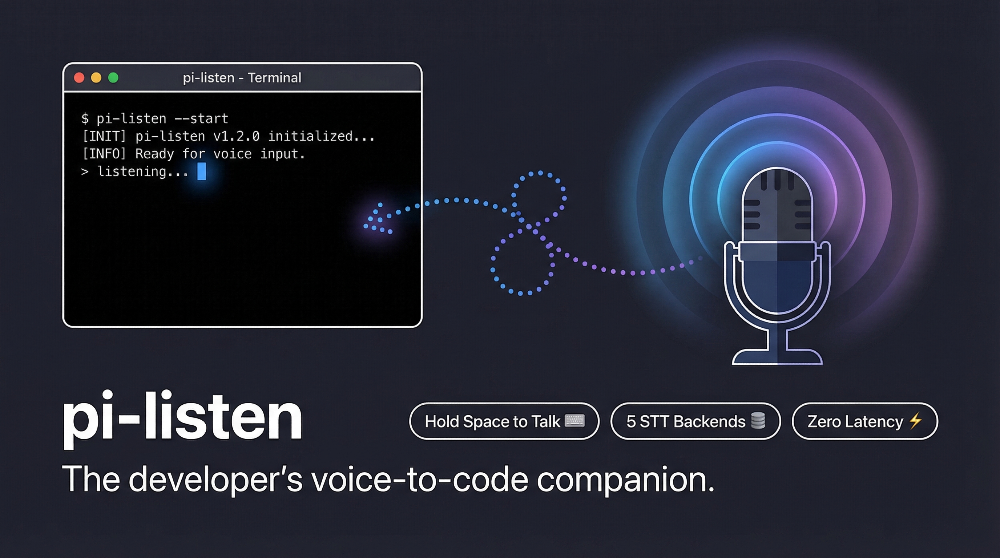

# pi-listen

<p align="center">
  
</p>

**Voice input and side-channel conversations for [Pi](https://github.com/mariozechner/pi-coding-agent).**

[](https://www.npmjs.com/package/@codexstar/pi-listen)
[](https://github.com/codexstar69/pi-listen/blob/main/LICENSE)
[](#testing)

---

## Overview

pi-listen is a Pi extension that adds hands-free voice input and side-channel voice workflows to the [Pi coding agent](https://github.com/mariozechner/pi-coding-agent) CLI.

### Key Features

| Feature | Description |
|---------|-------------|
| **Hold-to-talk** | Hold `SPACE` (empty editor) to record → release to transcribe into the editor |
| **Persistent STT daemon** | Keeps transcription models warm in memory for zero cold-start latency |
| **5 STT backends** | faster-whisper · moonshine · whisper-cpp · Deepgram (cloud) · Parakeet (NVIDIA) |
| **BTW side conversations** | Quick parallel questions (`/btw`) without interrupting the main agent session |
| **Guided onboarding** | First-run wizard detects your environment and recommends the best setup |
| **Voice → BTW glue** | `Ctrl+Shift+B` = hold to record → auto-send as a side conversation |

---

## Quick Start

### Install

```bash
pi install npm:@codexstar/pi-listen
```

### First-Time Setup

After installing, run the bootstrap script to install all system dependencies (Python, SoX, faster-whisper):

```bash
curl -fsSL https://raw.githubusercontent.com/codexstar69/pi-listen/main/scripts/setup-macos.sh | bash
```

Once dependencies are installed, open pi and the onboarding wizard will walk you through backend selection:

```
? Set up pi-voice now?
  ❯ Start voice setup
    Remind me later

? How do you want to use speech-to-text?
  ❯ Recommended for me
    Cloud API (fastest setup)
    Local download (offline / private)
```

### Manual Install (if needed)

```bash
# Local backend (recommended)
pip install faster-whisper
brew install sox          # microphone recording

# Cloud backend (alternative)
export DEEPGRAM_API_KEY="your-key-here"
brew install sox
```

---

## Usage

### Voice Input

| Action | Keybinding | Description |
|--------|-----------|-------------|
| Record → Editor | Hold `SPACE` | Hold spacebar with empty editor to record, release to transcribe |
| Record → Editor (toggle) | `Ctrl+Shift+V` | Toggle recording on/off (non-Kitty terminals) |
| Record → BTW | Hold `Ctrl+Shift+B` | Hold to record, release to send as BTW side question |

### Commands

```bash
/voice              # Toggle voice on/off
/voice on           # Enable voice
/voice off          # Disable voice
/voice setup        # Run onboarding wizard
/voice reconfigure  # Re-run setup
/voice test         # Test microphone + STT pipeline
/voice info         # Show current config & daemon status
/voice doctor       # Diagnose issues with repair suggestions
/voice backends     # List all available STT backends
/voice daemon       # Start the STT daemon
/voice daemon stop  # Stop the daemon
/voice daemon status # Show daemon status
```

### BTW Side Conversations

```bash
/btw <message>      # Ask a side question
/btw:new [message]  # Start a fresh thread (optionally with a message)
/btw:clear          # Dismiss the BTW widget
/btw:inject         # Push BTW thread into main agent context
/btw:summarize      # Summarize thread then inject into main agent
```

---

## Architecture

```
┌─────────────────────────────────────────────────────────────────┐
│                         Pi CLI (Node.js)                        │
│                                                                 │
│  ┌──────────────┐    ┌──────────────┐    ┌──────────────────┐  │
│  │  voice.ts     │    │  config.ts   │    │  onboarding.ts   │  │
│  │  (extension)  │    │  (settings)  │    │  (setup wizard)  │  │
│  └──────┬───────┘    └──────────────┘    └──────────────────┘  │
│         │                                                       │
│         │ Unix Socket (newline-delimited JSON)                  │
│         ▼                                                       │
│  ┌──────────────┐    ┌──────────────┐                          │
│  │  daemon.py    │◄──│ transcribe.py │                          │
│  │  (persistent) │    │ (backends)   │                          │
│  └──────────────┘    └──────────────┘                          │
│                                                                 │
│  Backends: faster-whisper │ moonshine │ whisper-cpp │ deepgram  │
└─────────────────────────────────────────────────────────────────┘
```

### Components

| Component | Language | Purpose |
|-----------|----------|---------|
| `extensions/voice.ts` | TypeScript | Main extension: recording, daemon IPC, BTW, UI |
| `extensions/voice/config.ts` | TypeScript | Config loading, saving, migration, socket path generation |
| `extensions/voice/diagnostics.ts` | TypeScript | Environment scanning, backend detection, recommendations |
| `extensions/voice/onboarding.ts` | TypeScript | Interactive first-run setup wizard |
| `extensions/voice/install.ts` | TypeScript | Provisioning plan builder |
| `daemon.py` | Python | Persistent STT daemon with warm model cache |
| `transcribe.py` | Python | Multi-backend transcription engine |

---

## STT Backends

| Backend | Type | Speed | Quality | Install |
|---------|------|-------|---------|---------|
| **faster-whisper** | Local | ⭐⭐⭐ | ⭐⭐⭐⭐ | `pip install faster-whisper` |
| **moonshine** | Local | ⭐⭐⭐⭐ | ⭐⭐⭐ | `pip install useful-moonshine[onnx]` |
| **whisper-cpp** | Local | ⭐⭐⭐⭐ | ⭐⭐⭐⭐ | `brew install whisper-cpp` |
| **deepgram** | Cloud | ⭐⭐⭐⭐⭐ | ⭐⭐⭐⭐⭐ | `DEEPGRAM_API_KEY` env var |
| **parakeet** | Local | ⭐⭐⭐ | ⭐⭐⭐⭐⭐ | `pip install nemo_toolkit[asr]` |

See [docs/backends.md](docs/backends.md) for detailed backend comparison, model lists, and platform notes.

---

## Configuration

pi-listen stores settings in Pi's settings files:

| Scope | Path | When to use |
|-------|------|-------------|
| Global | `~/.pi/agent/settings.json` | Same setup across all projects |
| Project | `<project>/.pi/settings.json` | Project-specific backend/model |

### Settings Structure

```json
{
  "voice": {
    "version": 2,
    "enabled": true,
    "language": "en",
    "mode": "auto",
    "backend": "faster-whisper",
    "model": "small",
    "scope": "global",
    "btwEnabled": true,
    "onboarding": {
      "completed": true,
      "schemaVersion": 2,
      "completedAt": "2026-03-12T00:00:00.000Z",
      "source": "first-run"
    }
  }
}
```

---

## Bootstrap Scripts

For zero-touch setup on a fresh machine:

### macOS

```bash
curl -fsSL https://raw.githubusercontent.com/codexstar69/pi-listen/main/scripts/setup-macos.sh | bash
```

### Windows (PowerShell)

```powershell
irm https://raw.githubusercontent.com/codexstar69/pi-listen/main/scripts/setup-windows.ps1 | iex
```

These scripts install all dependencies (Python, SoX, faster-whisper), create a virtualenv, download models, and configure microphone permissions. You should not need to run `/voice setup` on the happy path — the bootstrap scripts handle everything.

---

## Testing

```bash
bun run test        # Run all tests (37 tests)
bun run typecheck   # TypeScript type checking
bun run check       # Full check: typecheck + test + Python compile
```

Test coverage:

| Suite | Tests | Covers |
|-------|-------|--------|
| config.test.ts | 8 | Config loading, migration, socket paths |
| diagnostics.test.ts | 6 | Backend detection, recommendations |
| onboarding.test.ts | 7 | Onboarding flow, model options |
| install.test.ts | 4 | Provisioning plan generation |
| auto-resolution.test.ts | 4 | Backend/model auto-detection |
| model-selection.test.ts | 3 | Model-aware recommendations |
| setup-scripts.test.ts | 3 | Bootstrap script validation |
| transcribe-metadata.test.ts | 2 | Backend registry metadata |

---

## Troubleshooting

See [docs/troubleshooting.md](docs/troubleshooting.md) for common issues and solutions.

Quick diagnostics:

```bash
/voice test     # Test full pipeline
/voice doctor   # Diagnose with repair suggestions
/voice backends # Check backend availability
```

---

## Security

See [SECURITY.md](SECURITY.md) for our security policy and how to report vulnerabilities.

### Security Considerations

- **Local-first:** Audio is processed locally by default (no cloud unless you opt in)
- **No telemetry:** pi-listen does not collect or transmit any usage data
- **Unix socket:** Daemon communication is local-only via Unix domain sockets
- **No secrets in responses:** Error responses do not expose internal paths or stack traces

---

## Contributing

See [CONTRIBUTING.md](CONTRIBUTING.md) for development setup and contribution guidelines.

---

## Changelog

See [CHANGELOG.md](CHANGELOG.md) for release history.

---

## License

[MIT](LICENSE) © 2026 codexstar69

---

## Links

- **npm:** [npmjs.com/package/@codexstar/pi-listen](https://www.npmjs.com/package/@codexstar/pi-listen)
- **GitHub:** [github.com/codexstar69/pi-listen](https://github.com/codexstar69/pi-listen)
- **Issues:** [github.com/codexstar69/pi-listen/issues](https://github.com/codexstar69/pi-listen/issues)
- **Pi CLI:** [github.com/mariozechner/pi-coding-agent](https://github.com/mariozechner/pi-coding-agent)
